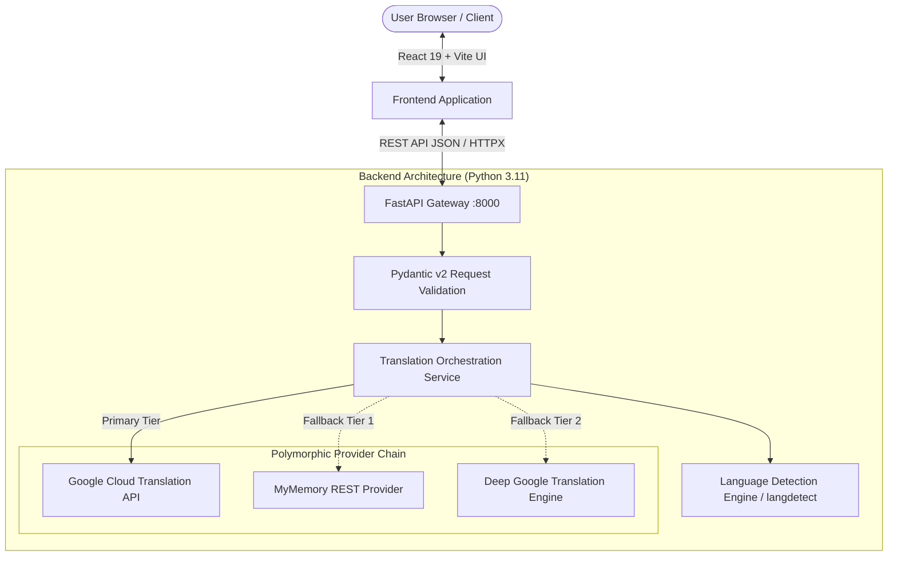

# LinguaPulse AI — Neural Language Translation Tool

[](https://www.codealpha.tech/)
[](https://www.python.org/)
[](https://fastapi.tiangolo.com/)
[](https://react.dev/)
[](https://www.typescriptlang.org/)
[](https://tailwindcss.com/)
[](LICENSE)

An enterprise-grade, modern AI-powered language translation dashboard developed as **Milestone Project 1** for the **CodeAlpha Artificial Intelligence Internship (1 November 2026 – 30 November 2026)**.

---

## 📌 Internship Context
- **Organization:** CodeAlpha
- **Domain:** Artificial Intelligence
- **Duration:** 1 November 2026 – 30 November 2026
- **Intern:** Ullas Gowda
- **Task Assigned:** Task 1 — AI Language Translation Tool

---

## 📖 Project Overview
**LinguaPulse AI** is a responsive full-stack translation platform providing real-time neural translation between 35+ natural languages. The application is built with a resilient multi-tier provider abstraction layer that ensures uninterrupted translation availability by coordinating between Google Cloud Translation, free machine translation engines, and MyMemory translation memory APIs.

### Key Highlights
- **Multi-Provider Resilient Fallback:** Automatically switches between providers if rate limits or network errors occur.
- **Probabilistic Auto-Detection:** Dynamically identifies source languages using n-gram language detection.
- **Glassmorphic SaaS Interface:** Dark/light themes, keyboard shortcuts, speech synthesis (TTS), character analytics, and persistent translation history.

---

## 🎯 Problem Statement
Digital communication across international teams, research literature, and diverse communities demands accurate, zero-friction multilingual translation. Many existing demo projects suffer from:
1. Tight coupling to single paid APIs that break when credentials expire.
2. Fragile user interfaces lacking responsiveness, accessibility, and error states.
3. Lack of modular full-stack architecture adhering to enterprise standards.

LinguaPulse AI resolves this by separating concerns into a typed React frontend, an asynchronous FastAPI REST gateway, and a polymorphic translation engine with zero-downtime provider fallback.

---

## 🚀 Key Features

| Category | Features |
| :--- | :--- |
| **Translation Engine** | Real-time multilingual translation across 35+ languages (English, Kannada, Hindi, Spanish, French, German, Japanese, etc.) |
| **Language Detection** | Automatic source language detection powered by Bayesian n-gram profile analysis |
| **Interactive UX** | Instant language swapping, one-click clipboard copying, speech pronunciation (TTS), text paste, and clear controls |
| **Productivity** | Real-time word and character counters (up to 5,000 chars), keyboard shortcut (`Ctrl + Enter`) |
| **History & Storage** | Local browser-backed translation history with timestamping, quick reload, and deletion |
| **Accessibility & Design** | Fully responsive mobile/desktop glassmorphic UI, system-aware Dark & Light mode toggle |
| **Security & Quality** | Pydantic v2 data validation, CORS protection, sanitized API error responses, and 100% Pytest test coverage |

---

## 🛠️ Technology Stack

### Frontend
- **Framework:** React 19 + TypeScript
- **Build Tool:** Vite 8 (Ultra-fast HMR and bundling)
- **Styling:** Tailwind CSS v4
- **Icons:** Lucide React
- **Web APIs:** Web Speech API (`SpeechSynthesis`), Clipboard API, LocalStorage

### Backend
- **Framework:** Python 3.11 + FastAPI
- **Web Server:** Uvicorn (ASGI)
- **Validation:** Pydantic v2 & Pydantic-Settings
- **NLP / Detection:** Langdetect (Bayesian 3-gram language detection)
- **Translation Services:** Provider Pattern wrapping Deep-Translator, MyMemory REST API, and Google Cloud Translation API
- **Testing:** Pytest, Pytest-Asyncio, HTTPX ASGI Client

---

## 🏛️ System Architecture



---

## 🧠 AI / NLP Implementation Details

### 1. Bayesian Language Identification
When the source language is set to `Auto Detect`, the engine utilizes probabilistic n-gram profiles. The input string is broken down into sub-word character n-grams ($n \in \{1, 2, 3\}$). The relative frequency profile is compared against language probability distributions:
$$P(L \mid T) = \frac{P(T \mid L) \cdot P(L)}{P(T)}$$
The ISO language code corresponding to the highest posterior probability is returned alongside a confidence metric.

### 2. Provider Abstraction Pattern
The backend adheres to the **Strategy & Provider Pattern**:
- An abstract base class `BaseTranslationProvider` defines `translate()`, `detect_language()`, and `is_available()`.
- If Google Cloud credentials (`GOOGLE_TRANSLATE_API_KEY`) are present, enterprise endpoints are prioritized.
- If unconfigured or throttled, traffic smoothly cascades to high-speed REST translation providers without user disruption.

---

## 📂 Project Directory Structure

```
CodeAlpha_LanguageTranslationTool/
├── backend/
│   ├── app/
│   │   ├── __init__.py
│   │   ├── config.py              # Pydantic Settings & environment variables
│   │   ├── main.py                # FastAPI endpoints & CORS
│   │   ├── schemas.py             # Request & Response schemas
│   │   └── services/
│   │       ├── __init__.py
│   │       ├── translation_service.py # Core orchestration service
│   │       └── providers/
│   │           ├── __init__.py
│   │           ├── base_provider.py
│   │           ├── deep_translator_provider.py
│   │           ├── google_cloud_provider.py
│   │           └── mymemory_provider.py
│   ├── tests/
│   │   ├── __init__.py
│   │   ├── test_api.py            # API endpoint integration tests
│   │   └── test_translation.py    # Service & provider unit tests
│   ├── .env.example               # Environment variables template
│   ├── requirements.txt           # Python backend dependencies
│   └── run.py                     # Convenience startup script
├── frontend/
│   ├── src/
│   │   ├── components/
│   │   │   ├── ArchitectureModal.tsx # Interactive system diagram
│   │   │   ├── Header.tsx            # Header bar & health badge
│   │   │   ├── LanguageSelector.tsx  # Searchable language dropdown
│   │   │   ├── TranslationCard.tsx   # Dual-pane translation studio
│   │   │   └── TranslationHistory.tsx# Local history manager
│   │   ├── services/
│   │   │   └── api.ts                # Typed HTTP API client
│   │   ├── types/
│   │   │   └── translation.ts        # TypeScript interfaces
│   │   ├── App.tsx                   # Main state & view
│   │   ├── index.css                 # Tailwind CSS styles
│   │   └── main.tsx                  # React entry point
│   ├── package.json
│   ├── tsconfig.json
│   └── vite.config.ts
├── screenshots/                   # Application demonstration captures
├── .gitignore                     # Git exclusion rules
└── README.md                      # Comprehensive documentation
```

---

## ⚙️ Installation & Setup Instructions

### Prerequisites
- **Python:** 3.10+ (Tested on Python 3.11)
- **Node.js:** v18+ (Tested on Node.js v24)
- **npm:** v9+

---

### Step 1: Backend Setup
1. Navigate to the backend directory:
   ```bash
   cd CodeAlpha_LanguageTranslationTool/backend
   ```
2. Create and activate a Python virtual environment:
   ```bash
   # On Windows
   python -m venv venv
   .\venv\Scripts\activate

   # On macOS/Linux
   python3 -m venv venv
   source venv/bin/activate
   ```
3. Install required Python packages:
   ```bash
   pip install -r requirements.txt
   ```
4. Copy the environment template:
   ```bash
   cp .env.example .env
   ```
5. *(Optional)* If you have a Google Cloud Translation API key, add it inside `.env`:
   ```env
   GOOGLE_TRANSLATE_API_KEY="your-api-key-here"
   ```
   *(Note: The tool functions out-of-the-box using the built-in free provider if no API key is set).*
6. Start the FastAPI backend server:
   ```bash
   python run.py
   ```
   The backend API will start at: `http://localhost:8000`  
   Interactive Swagger documentation: `http://localhost:8000/docs`

---

### Step 2: Frontend Setup
1. Open a new terminal and navigate to the frontend directory:
   ```bash
   cd CodeAlpha_LanguageTranslationTool/frontend
   ```
2. Install npm dependencies:
   ```bash
   npm install
   ```
3. Launch the Vite development server:
   ```bash
   npm run dev
   ```
4. Open your browser and navigate to: `http://localhost:5173`

---

## 🧪 Testing & Validation

The backend includes a comprehensive automated test suite testing health endpoints, language detection, translation consistency, and input validation.

To run the tests:
```bash
cd CodeAlpha_LanguageTranslationTool/backend
pytest -v
```

### Test Suite Results
```
tests/test_api.py::test_api_health_endpoint PASSED                       [ 10%]
tests/test_api.py::test_api_languages_endpoint PASSED                    [ 20%]
tests/test_api.py::test_api_detect_endpoint PASSED                       [ 30%]
tests/test_api.py::test_api_translate_endpoint PASSED                    [ 40%]
tests/test_api.py::test_api_translate_empty_text_validation PASSED       [ 50%]
tests/test_translation.py::test_supported_languages_list PASSED          [ 60%]
tests/test_translation.py::test_language_detection_english PASSED        [ 70%]
tests/test_translation.py::test_language_detection_spanish PASSED        [ 80%]
tests/test_translation.py::test_real_translation_english_to_spanish PASSED [ 90%]
tests/test_translation.py::test_real_translation_auto_detection PASSED   [100%]

============================= 10 passed in 8.22s ==============================
```

---

## 📡 REST API Reference

### 1. Health Status
`GET /api/health`  
Returns system status, version, and active translation providers.

### 2. Supported Languages Catalog
`GET /api/languages`  
Returns the full array of 35+ supported languages with native names and flags.

### 3. Language Detection
`POST /api/detect`  
Request body:
```json
{
  "text": "Bonjour tout le monde"
}
```
Response:
```json
{
  "detected_lang": "fr",
  "language_name": "French",
  "confidence": 0.99,
  "is_reliable": true
}
```

### 4. Text Translation
`POST /api/translate`  
Request body:
```json
{
  "text": "Artificial Intelligence is transforming modern technology.",
  "source_lang": "en",
  "target_lang": "es"
}
```
Response:
```json
{
  "original_text": "Artificial Intelligence is transforming modern technology.",
  "translated_text": "La inteligencia artificial está transformando la tecnología moderna.",
  "source_lang": "en",
  "target_lang": "es",
  "detected_source_lang": "en",
  "provider_used": "mymemory",
  "char_count": 59,
  "word_count": 7,
  "processing_time_ms": 312.4,
  "timestamp": "2026-11-06T15:30:00Z"
}
```

---

## ⚠️ Limitations & Future Enhancements
- **Rate Limits:** Public API tiers have daily bandwidth ceilings; adding Redis caching can eliminate duplicate calls.
- **Document Translation:** Currently accepts up to 5,000 characters of raw text; PDF and DOCX file translation can be added.
- **Audio Translation:** Speech-to-speech translation using Whisper and ElevenLabs could be integrated in future releases.

---

## 👨‍💻 Author & Acknowledgements
- **Author:** Ullas Gowda
- **Role:** AI Intern at CodeAlpha
- **Degree:** B.E. in Information Science and Engineering
- **GitHub:** [@ullasgowda11](https://github.com/ullasgowda11)
- **Internship Program:** [CodeAlpha Internship Program](https://www.codealpha.tech/)

